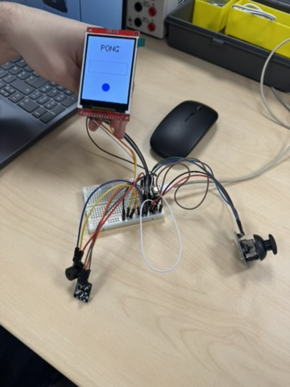

# 2026-11-24 : Montage final sur breadboard

**Séance :** planifiée · **Durée :** 1 h 30

## Fait

Nous avons réalisé le montage final sur breadboard avec le bouton, l'écran, le buzzer et le joystick.

## Reste à faire

Nous devons commencer à faire le carte sur kicad.